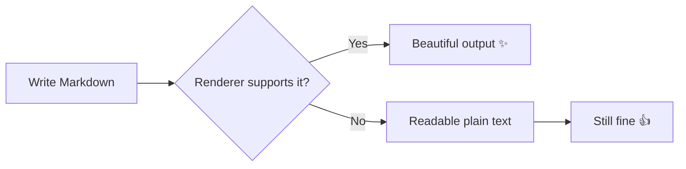
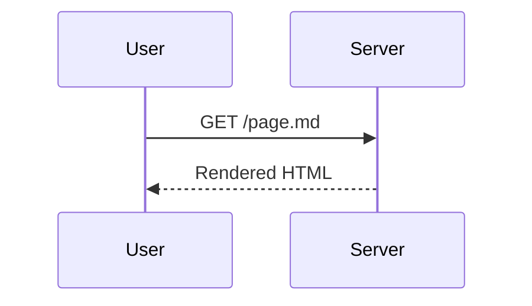
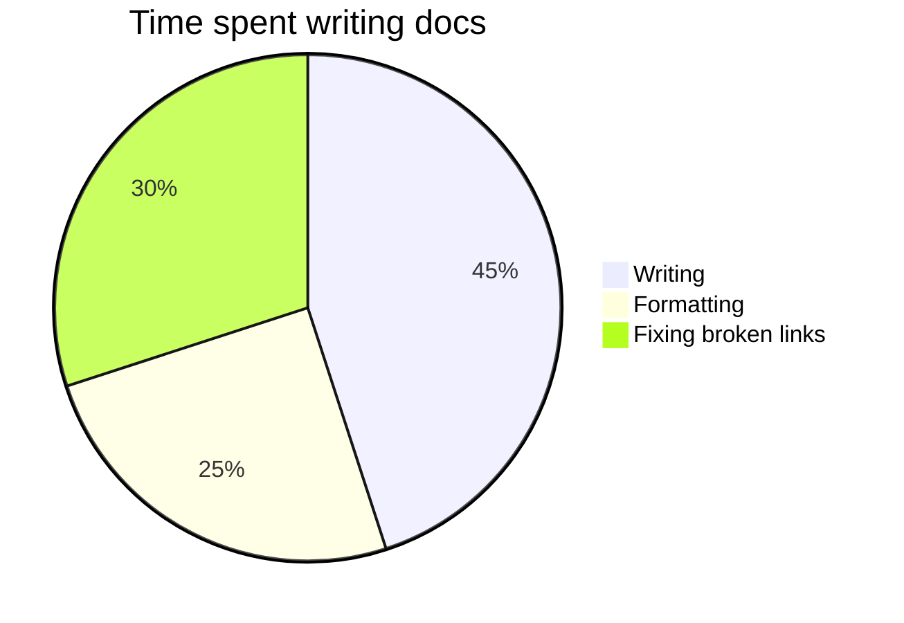

# Markdown Rendering Showcase

A tour of what Markdown can do, from the basics of CommonMark to the extensions found in GitHub Flavored Markdown (GFM) and other popular renderers.

> **Note:** Support varies by renderer. Sections marked *(extension)* may show as plain text in some viewers.

---

## Table of Contents

1. [Headings](#headings)
2. [Text Formatting](#text-formatting)
3. [Lists](#lists)
4. [Links and Images](#links-and-images)
5. [Blockquotes](#blockquotes)
6. [Code](#code)
7. [Tables](#tables)
8. [Horizontal Rules](#horizontal-rules)
9. [Footnotes](#footnotes)
10. [Alerts and Callouts](#alerts-and-callouts)
11. [Math](#math)
12. [Diagrams](#diagrams)
13. [Inline HTML](#inline-html)
14. [Escaping and Line Breaks](#escaping-and-line-breaks)

---

## Headings

# Heading level 1
## Heading level 2
### Heading level 3
#### Heading level 4
##### Heading level 5
###### Heading level 6

Alternate (Setext) heading level 1
===================================

Alternate (Setext) heading level 2
-----------------------------------

---

## Text Formatting

| Style | Syntax | Result |
|---|---|---|
| Bold | `**bold**` or `__bold__` | **bold** |
| Italic | `*italic*` or `_italic_` | *italic* |
| Bold + italic | `***both***` | ***both*** |
| Strikethrough *(extension)* | `~~struck~~` | ~~struck~~ |
| Inline code | `` `code` `` | `code` |
| Highlight *(extension)* | `==marked==` | ==marked== |
| Subscript (HTML) | `H<sub>2</sub>O` | H<sub>2</sub>O |
| Superscript (HTML) | `E = mc<sup>2</sup>` | E = mc<sup>2</sup> |
| Keyboard keys (HTML) | `<kbd>Ctrl</kbd>+<kbd>C</kbd>` | <kbd>Ctrl</kbd>+<kbd>C</kbd> |

Formatting can be **nested, *combined*, and ~~mixed~~ freely** within a single sentence.

Emoji shortcodes *(extension)*: :rocket: :tada: :sparkles: — or just paste them directly: 🚀 🎉 ✨

---

## Lists

### Unordered

- Fruits
  - Apples
    - Granny Smith
    - Honeycrisp
  - Oranges
- Vegetables
* Asterisks work too
+ And so do plus signs

### Ordered

1. Preheat the oven
2. Mix the ingredients
   1. Dry ingredients first
   2. Then wet ingredients
3. Bake for 25 minutes

Ordered lists can start at any number:

7. Seventh item
8. Eighth item
9. Ninth item

### Task Lists *(extension)*

- [x] Write the outline
- [x] Draft each section
- [ ] Proofread
- [ ] Publish

### Lists With Rich Content

1. **A step with a paragraph.**

   This paragraph belongs to the first list item because it is indented.

2. **A step with code:**

   ```bash
   npm install
   npm run build
   ```

3. **A step with a quote:**

   > Indented blockquotes stay inside the list.

### Definition Lists *(extension)*

Markdown
: A lightweight markup language for formatting plain text.

CommonMark
: A strongly specified, unambiguous standard for Markdown syntax.

---

## Links and Images

### Links

- Inline link: [CommonMark](https://commonmark.org)
- Link with a title (hover over it): [GitHub Docs](https://docs.github.com "GitHub's documentation")
- Autolink: <https://example.com>
- Bare URL *(extension)*: https://example.com
- Email autolink: <hello@example.com>
- Reference-style link: [the Markdown guide][guide]
- Internal anchor: [jump back to the top](#markdown-rendering-showcase)

[guide]: https://www.markdownguide.org "The Markdown Guide"

### Images


A linked image (click it):

[](https://picsum.photos)

---

## Blockquotes

> A single-line blockquote.

> A multi-paragraph blockquote.
>
> It can contain **formatting**, `code`, and [links](https://example.com).
>
> - Lists work
> - Inside quotes too
>
> > And quotes can be nested.
> >
> > > As deep as you like.

---

## Code

Inline: use `git status` to check your working tree.

### Fenced Code Block (no language)

```
Plain preformatted text.
    Whitespace is preserved exactly.
```

### Syntax Highlighting

```python
from dataclasses import dataclass

@dataclass
class Point:
    x: float
    y: float

    def distance_to(self, other: "Point") -> float:
        return ((self.x - other.x) ** 2 + (self.y - other.y) ** 2) ** 0.5

print(Point(0, 0).distance_to(Point(3, 4)))  # 5.0
```

```javascript
const greet = (name = "world") => `Hello, ${name}!`;
console.log(greet("Markdown"));
```

```json
{
  "name": "markdown-showcase",
  "version": "1.0.0",
  "features": ["tables", "footnotes", "math"]
}
```

```diff
- const color = "red";
+ const color = "blue";
  const size = "large";
```

```sql
SELECT name, COUNT(*) AS orders
FROM customers
JOIN orders USING (customer_id)
GROUP BY name
ORDER BY orders DESC;
```

### Indented Code Block

    Four spaces of indentation
    also create a code block.

### Showing Backticks

To display a literal fence, wrap it in a longer one:

````markdown
```python
print("fenced inside a fence")
```
````

---

## Tables

### Column Alignment

| Left-aligned | Centered | Right-aligned |
|:-------------|:--------:|--------------:|
| Apple | 🍎 | $1.20 |
| Banana | 🍌 | $0.50 |
| Cherry | 🍒 | $4.75 |
| **Total** | | **$6.45** |

### Formatting Inside Tables

| Feature | Supported | Notes |
|---|:---:|---|
| `**bold**` | ✅ | Works in cells |
| [Links](https://example.com) | ✅ | Clickable |
| Pipes | ✅ | Escape with `\|` like this: a \| b |
| Multi-line | ❌ | Use `<br>` instead:<br>second line |

---

## Horizontal Rules

Three or more hyphens, asterisks, or underscores:

---

***

___

---

## Footnotes *(extension)*

Markdown was created in 2004.[^1] Many flavours have appeared since then.[^flavors]

[^1]: It was designed to be readable as plain text, before any rendering.
[^flavors]: Examples include GitHub Flavored Markdown, MultiMarkdown, and Markdown Extra.

---

## Alerts and Callouts *(extension)*

> [!NOTE]
> Useful information the reader should know, even when skimming.

> [!TIP]
> Helpful advice for doing things better or more easily.

> [!IMPORTANT]
> Key information the reader needs to achieve their goal.

> [!WARNING]
> Urgent information that needs immediate attention to avoid problems.

> [!CAUTION]
> Advice about risks or negative outcomes of certain actions.

---

## Math *(extension)*

Inline math: the quadratic formula is $x = \frac{-b \pm \sqrt{b^2 - 4ac}}{2a}$.

Block math:

$$
\int_{-\infty}^{\infty} e^{-x^2} \, dx = \sqrt{\pi}
$$

$$
\begin{bmatrix}
1 & 2 \\
3 & 4
\end{bmatrix}
\begin{bmatrix}
x \\
y
\end{bmatrix}
=
\begin{bmatrix}
5 \\
6
\end{bmatrix}
$$

---

## Diagrams *(extension)*

### Flowchart



### Sequence Diagram



### Pie Chart



---

## Inline HTML

Most renderers allow a safe subset of HTML.

<details>
<summary><strong>Click to expand a collapsible section</strong></summary>

Hidden content goes here. It can include **Markdown** too:

- Item one
- Item two

```bash
echo "Surprise!"
```

</details>

<p align="center">
  <em>Centered text using an HTML paragraph.</em>
</p>

<abbr title="HyperText Markup Language">HTML</abbr> abbreviations show a tooltip on hover.

<!-- This is an HTML comment. It won't appear in the rendered output. -->

---

## Escaping and Line Breaks

### Escaping Special Characters

Use a backslash to show characters literally:

\*not italic\* · \_not italic\_ · \# not a heading · \[not a link\](url) · \`not code\`

Characters that can be escaped: `\ ` `` ` `` `*` `_` `{}` `[]` `()` `#` `+` `-` `.` `!` `|`

### Line Breaks

End a line with two spaces  
to force a line break,
or use a backslash\
or an HTML `<br>` tag.<br>All three work.

A blank line starts a new paragraph.

---

<p align="center">
  <sub>Made with Markdown · Last updated November 2026</sub>
</p>
